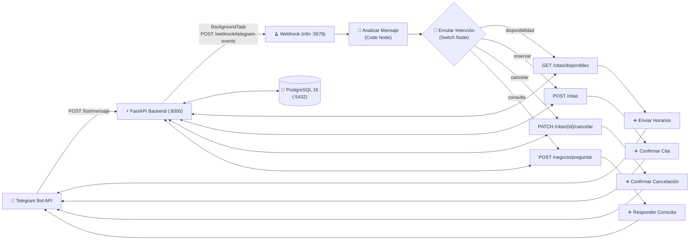

# 🤖 Automation Hub: Backend de Reservas & Asistente Telegram con n8n


> Ecosistema de automatización comercial que integra un motor de reservas y base de conocimiento en **FastAPI + PostgreSQL** con flujos de trabajo en **n8n** para atención automatizada de clientes vía **Telegram**.

---

## 📋 Tabla de Contenidos

- [Descripción General](#-descripción-general)
- [Arquitectura del Sistema](#-arquitectura-del-sistema)
- [Estructura del Repositorio](#-estructura-del-repositorio)
- [Requisitos Previos](#-requisitos-previos)
- [Instalación y Despliegue Rápido](#-instalación-y-despliegue-rápido)
- [Variables de Entorno](#-variables-de-entorno)
- [Referencia de la API (FastAPI)](#-referencia-de-la-api-fastapi)
- [Flujo de Automatización en n8n](#-flujo-de-automatización-en-n8n)
- [Modelo de Datos](#-modelo-de-datos)

---

## 🎯 Descripción General

**Automation Hub** desacopla la lógica transaccional y de persistencia de la orquestación conversacional:

1. **Motor de Reservas (`/citas`)**: Calcula disponibilidad horaria en tiempo real (`09:00` a `17:00`), registra nuevas citas evitando colisiones de horarios (`409 Conflict`) y permite cancelaciones instantáneas.
2. **Gateway de Eventos de Telegram (`/bot`)**: Recibe actualizaciones (`Update`) de Telegram, responde inmediatamente `200 OK` para evitar reintentos del webhook y despacha la carga útil en segundo plano (`BackgroundTasks`) hacia **n8n**.
3. **Base de Conocimiento del Negocio (`/negocio`)**: Permite alimentar e interrogar secciones operativas (precios, horarios, políticas, preguntas frecuentes) mediante búsqueda por palabras clave en PostgreSQL para asistir a flujos de IA o respuestas automatizadas en n8n.

---

## 🏗️ Arquitectura del Sistema



---

## 📁 Estructura del Repositorio

```text
automation-n8n/
├── .ai/
│   └── backend.md                          # Especificación técnica y funcional del sistema
├── backend/                                # Servicio API REST en FastAPI
│   ├── app/
│   │   ├── api/v1/
│   │   │   ├── endpoints/
│   │   │   │   ├── bot.py                  # Webhook receptor de Telegram y despacho a n8n
│   │   │   │   ├── citas.py                # Disponibilidad, reserva y cancelación de citas
│   │   │   │   └── negocio.py              # Ingesta y consulta de base de conocimiento
│   │   │   └── router.py                   # Enrutador principal de la API
│   │   ├── core/
│   │   │   ├── config.py                   # Configuración con Pydantic Settings
│   │   │   └── database.py                 # Motor SQLAlchemy y sesión de PostgreSQL
│   │   ├── models/
│   │   │   └── models.py                   # Modelos ORM: Cita, NegocioInformacion
│   │   ├── schemas/
│   │   │   └── schemas.py                  # Esquemas Pydantic v2 (validación e I/O)
│   │   └── main.py                         # Punto de entrada FastAPI, CORS y Lifespan
│   ├── .env.example                        # Plantilla de variables de entorno
│   ├── Dockerfile                          # Imagen Python 3.11-slim para el backend
│   ├── README.md                           # Documentación específica del backend
│   ├── requirements.txt                    # Dependencias de Python
│   └── run.py                              # Script de arranque local con Uvicorn
├── n8n-server/
│   ├── docker-compose.yml                  # Contenedor independiente para el servidor n8n
│   └── workflow-reservas-telegram.json     # Flujo completo exportado de n8n (11 nodos)
├── .gitignore                              # Exclusiones de Git
├── docker-compose.yml                      # Orquestación principal (PostgreSQL + Backend)
└── README.md                               # Documentación general del proyecto
```

---

## 🔧 Requisitos Previos

- **Docker** y **Docker Compose** (v2+)
- **Python 3.11+** *(solo si deseas ejecutar el backend fuera de Docker)*
- Un **Bot de Telegram** creado con [@BotFather](https://t.me/BotFather) (para configurar las credenciales en n8n)

---

## 🚀 Instalación y Despliegue Rápido

### 1. Levantar el Servidor n8n

El servidor de **n8n** se encuentra en `n8n-server/` para mantener su volumen de datos independiente:

```powershell
cd n8n-server
docker compose up -d
```

- **Panel web de n8n:** [http://localhost:5678](http://localhost:5678)

### 2. Levantar Base de Datos y Backend (FastAPI + PostgreSQL)

Desde la raíz del proyecto (`automation-n8n/`):

```powershell
cd ..
docker compose up --build -d
```

- **API Backend:** [http://localhost:8000](http://localhost:8000)
- **Documentación Interactiva (Swagger UI):** [http://localhost:8000/docs](http://localhost:8000/docs)
- **Redoc:** [http://localhost:8000/redoc](http://localhost:8000/redoc)
- **Health Check:** [http://localhost:8000/health](http://localhost:8000/health)

### 3. Ejecución Local del Backend (Sin Docker para FastAPI)

Si prefieres correr únicamente la base de datos en Docker (`docker compose up -d db`) y el backend en tu entorno local:

```powershell
cd backend
python -m venv .venv
.\.venv\Scripts\Activate.ps1
pip install -r requirements.txt
Copy-Item .env.example .env
python run.py
```

---

## ⚙️ Variables de Entorno

El servicio `backend` utiliza las siguientes variables de entorno (configuradas en `docker-compose.yml` o en `backend/.env`):

| Variable | Descripción | Valor por Defecto (Docker) |
| :--- | :--- | :--- |
| `PROJECT_NAME` | Nombre del proyecto en OpenAPI | `Backend Reservas & Automatizacion Telegram` |
| `VERSION` | Versión de la API | `1.0.0` |
| `API_V1_STR` | Prefijo global de rutas | `""` (vacío, rutas en raíz) |
| `DATABASE_URL` | Cadena de conexión a PostgreSQL | `postgresql://postgres:postgrespassword@db:5432/automation_hub` |
| `N8N_WEBHOOK_URL` | URL del Webhook de n8n para eventos de Telegram | `http://host.docker.internal:5678/webhook-test/telegram-events` |

> [!TIP]
> Cuando publiques (actives) el flujo en **n8n** para producción, actualiza `N8N_WEBHOOK_URL` cambiando `/webhook-test/` por `/webhook/`:
> `http://host.docker.internal:5678/webhook/telegram-events`

---

## 📖 Referencia de la API (FastAPI)

### 📅 Módulo de Reservas y Citas (`/citas`)

| Método | Endpoint | Descripción |
| :--- | :--- | :--- |
| `GET` | `/citas/disponibles` | Devuelve los horarios libres (`09:00` a `17:00`) para una `fecha` (`YYYY-MM-DD`). |
| `POST` | `/citas` | Crea una cita en estado `CONFIRMADO`. Retorna `409 Conflict` si la hora ya está ocupada. |
| `PATCH` | `/citas/{id}/cancelar` | Cambia el estado de una cita a `CANCELADO`, liberando el horario automáticamente. |

<details>
<summary><b>Ver ejemplos de payloads en <code>/citas</code></b></summary>

#### Consultar disponibilidad (`GET /citas/disponibles?fecha=2026-10-15`)
```json
{
  "fecha": "2026-10-15",
  "horarios_libres": ["09:00", "10:00", "11:00", "12:00", "14:00", "15:00", "16:00", "17:00"]
}
```

#### Crear cita (`POST /citas`)
```json
{
  "cliente_nombre": "Carlos Perez",
  "cliente_contacto": "@carlosperez / +51999888777",
  "servicio": "Consulta General",
  "fecha_hora": "2026-10-15T10:00:00"
}
```
</details>

---

### 💬 Módulo de Webhook Telegram (`/bot`)

| Método | Endpoint | Descripción |
| :--- | :--- | :--- |
| `POST` | `/bot/mensaje` | Recibe un objeto `Update` de Telegram, extrae `chat_id`, `usuario`, `username` y `texto`, responde `200 OK` al instante y lo reenvía a `N8N_WEBHOOK_URL` en segundo plano. |

<details>
<summary><b>Ver ejemplo de payload en <code>/bot/mensaje</code></b></summary>

```json
{
  "update_id": 10000,
  "message": {
    "message_id": 136,
    "from": {
      "id": 1111111,
      "first_name": "Carlos",
      "username": "carlosperez"
    },
    "chat": {
      "id": 1111111,
      "type": "private"
    },
    "text": "Hola, quiero agendar una cita"
  }
}
```
</details>

---

### 🧠 Módulo de Base de Conocimiento (`/negocio`)

| Método | Endpoint | Descripción |
| :--- | :--- | :--- |
| `POST` | `/negocio/datos` | Almacena un bloque de conocimiento operativo (`seccion` y `contenido`). |
| `POST` | `/negocio/preguntar` | Extrae palabras clave de la pregunta y busca coincidencias (`ILIKE`) en `seccion` y `contenido`. |

<details>
<summary><b>Ver ejemplos de payloads en <code>/negocio</code></b></summary>

#### Ingesta de datos (`POST /negocio/datos`)
```json
{
  "seccion": "Precios",
  "contenido": "Consulta general S/ 50. Limpieza dental S/ 80."
}
```

#### Consultar conocimiento (`POST /negocio/preguntar`)
```json
{
  "pregunta": "¿Cuánto cuesta la consulta?"
}
```
</details>

---

## 🔄 Flujo de Automatización en n8n

El flujo **`Asistente de Reservas Telegram`** (`ID: DRUloAjf2pqYRs4v`, versionado en [`n8n-server/workflow-reservas-telegram.json`](n8n-server/workflow-reservas-telegram.json)) se encuentra **publicado y activo** con **11 nodos** organizados en 5 grupos:

1. **Webhook (`POST /webhook/telegram-events`)**: Escucha los eventos despachados en segundo plano por el endpoint `/bot/mensaje` de FastAPI.
2. **Triage y Enrutamiento (`Analizar Mensaje` + `Enrutar Intencion`)**:
   - Extrae fechas (`YYYY-MM-DD`, o usa la fecha actual por defecto), horas (`HH:MM`), nombre del servicio e `ID` de cita.
   - Clasifica el mensaje en 4 intenciones y las enruta mediante un nodo **Switch**:
     - **`disponibilidad`** $\rightarrow$ `GET /citas/disponibles?fecha=YYYY-MM-DD` $\rightarrow$ Responde en Telegram con los horarios libres y ejemplos de reserva.
     - **`reservar`** $\rightarrow$ `POST /citas` $\rightarrow$ Registra la cita en estado `CONFIRMADO` y envía el comprobante con código `#ID` en Telegram (o informa conflicto si el turno ya fue ocupado).
     - **`cancelar`** $\rightarrow$ `PATCH /citas/{id}/cancelar` $\rightarrow$ Libera el horario cambiando el estado a `CANCELADO` y confirma al usuario en Telegram.
     - **`consulta` (Fallback)** $\rightarrow$ `POST /negocio/preguntar` $\rightarrow$ Busca respuestas en la base de conocimiento del negocio (precios, servicios, horarios) y responde en Telegram junto con el menú rápido de comandos.

---

## 🗄️ Modelo de Datos

Las tablas se inicializan automáticamente al arrancar FastAPI mediante el `lifespan` de SQLAlchemy:

- **`citas`**:
  - `id` (`Integer`, PK)
  - `cliente_nombre` (`String(255)`)
  - `cliente_contacto` (`String(255)`)
  - `servicio` (`String(255)`)
  - `fecha_hora` (`DateTime`, Index)
  - `estado` (`String(50)`, Index — `"CONFIRMADO"` | `"CANCELADO"`)
  - `creado_en` (`DateTime`, UTC)
- **`negocio_informacion`**:
  - `id` (`Integer`, PK)
  - `seccion` (`String(100)`, Index)
  - `contenido` (`Text`)
